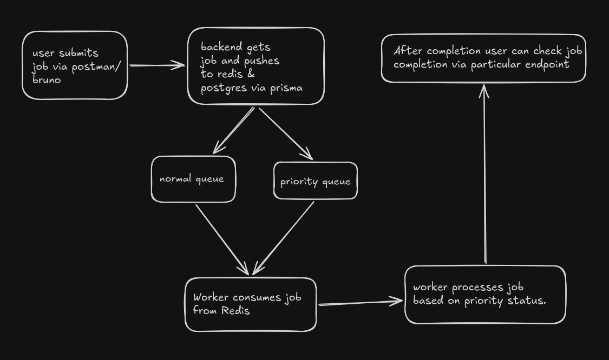

# **Task Forge**

## Fully functional task queue system that shows how a queue works

TaskForge is queue system that queue's the task provided and exectutes/completes the task and notifies user after completion.

## **Tech Stack**

- Runtime: Bun.js
- Language: Typescript
- Framework: Fastify.js
- Database: Postgres with Prisma ORM
- Queue: Redis

## **Basic Architecture**



## Quick Setup

### Installation:

1.  Clone the repository

```
git clone https://github.com/kaiz3n08/TaskForge.git
```

2. Install Dependencies

```
bun install
```

3. Set up enivroment variables (`.env`)  

4. Run migration 
```
bun migrate
```
5. Start Backend
```
bun dev 
```
6. Start Worker
```
bun worker
```
